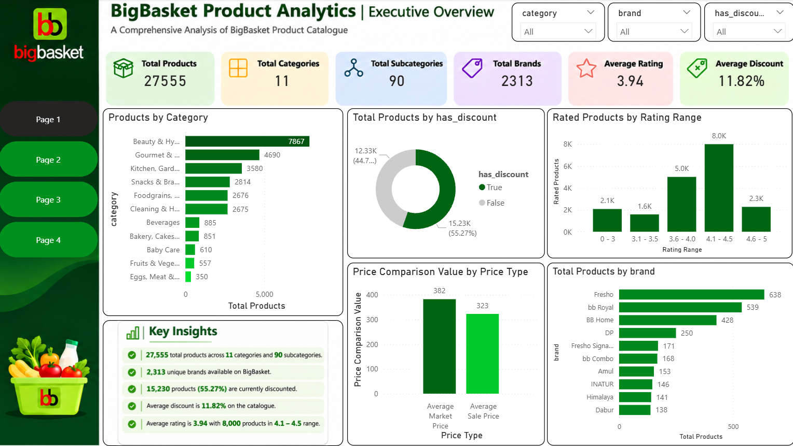
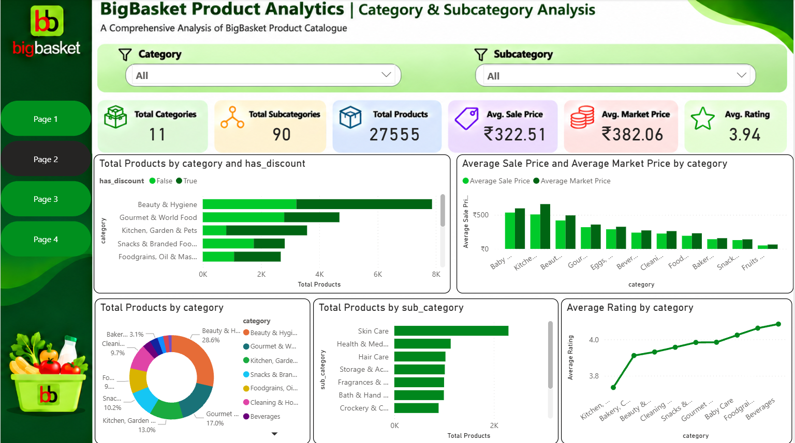
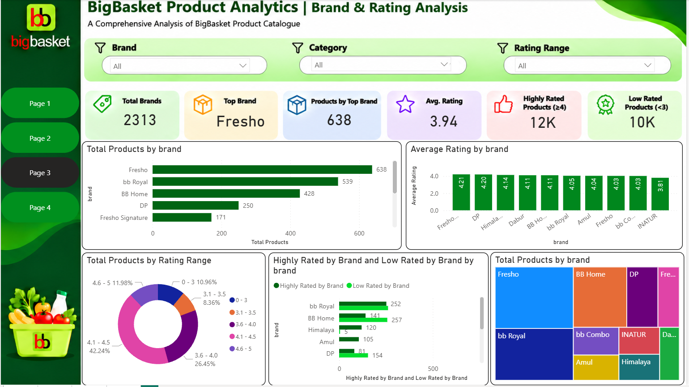
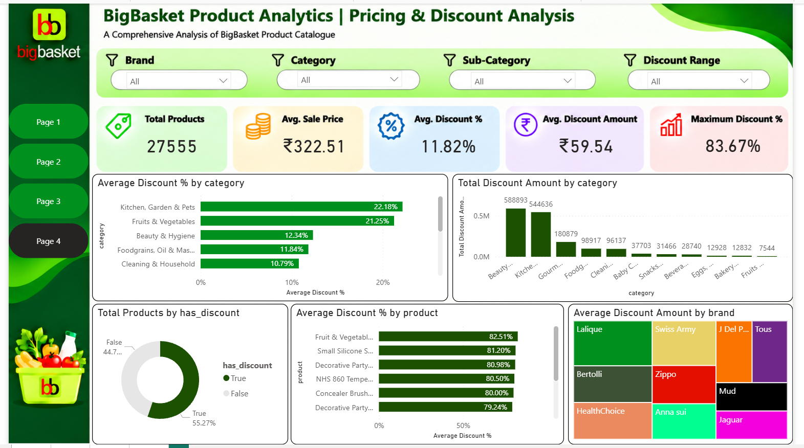

# BigBasket Product Intelligence & Pricing Analytics

## Project Overview
An end-to-end Data Analytics project focused on analysing BigBasket's product catalogue, pricing patterns, discounts, brands, categories and customer ratings.

## Dataset
- Dataset: BigBasket Entire Product List
- Total Records: 27,555
- Categories: 11
- Subcategories: 90
- Unique Brands: 2,313

## Tools & Technologies
- Python – Data Cleaning and Exploratory Data Analysis
- Pandas, NumPy, Matplotlib, Seaborn
- MySQL – Data Storage and SQL Analysis
- Excel – Summary Analysis
- Power BI – Interactive Dashboard
- DAX – KPIs and Measures

## Project Workflow

### 1. Python
- Data loading and inspection
- Missing-value and duplicate checks
- Data cleaning and preprocessing
- Price and discount calculations
- Exploratory Data Analysis
- Exported cleaned datasets and summaries

### 2. Excel
- Category and subcategory analysis
- Brand and product summaries
- Discount and rating analysis

### 3. MySQL
- Database and table creation
- Data import and validation
- SQL-based analytical queries
- Pricing, discount, brand and category analysis

### 4. Power BI
Created a four-page interactive dashboard:

1. Executive Overview
2. Category & Subcategory Analysis
3. Brand & Rating Analysis
4. Pricing & Discount Analysis

Includes KPI cards, interactive slicers, charts and DAX measures.

## Key Findings
- 27,555 products across 11 categories.
- 90 unique subcategories.
- 2,313 unique brands.
- Average product rating: 3.94.
- Average discount percentage: 11.82%.
- Average sale price: ₹322.51.

## Project Objective
To demonstrate an end-to-end data analytics workflow using Python, Excel, SQL and Power BI.

## Important Dataset Limitation
This dataset represents a product catalogue, not transaction-level sales data. Therefore, this project focuses on catalogue, pricing, discount and rating analysis rather than actual revenue or customer purchasing behaviour.

## 📊 Power BI Dashboard Preview

### Page 1 – Executive Overview

### Page 2 – Category & Subcategory Analysis

### Page 3 – Brand & Rating Analysis

### Page 4 – Pricing & Discount Analysis

